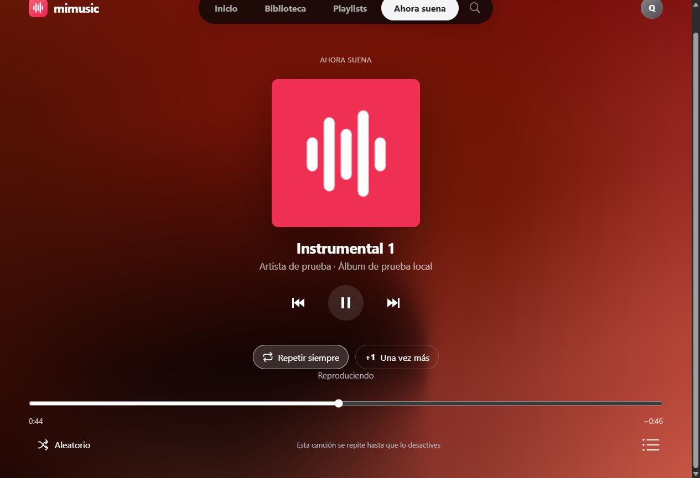
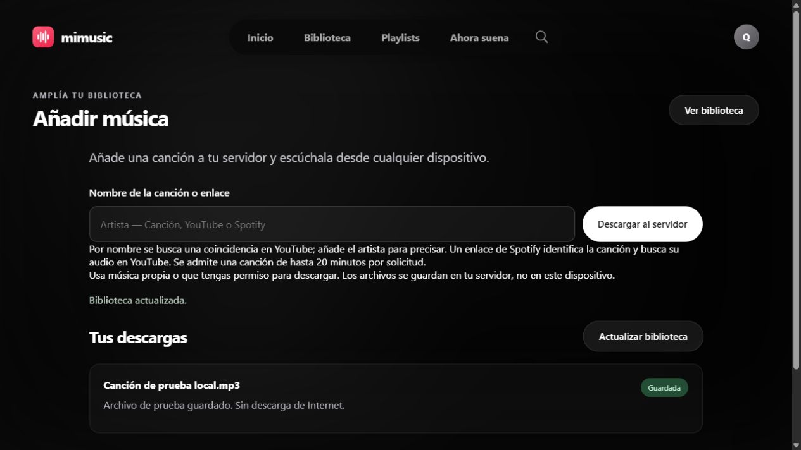
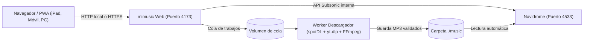

<div align="center">


# mimusic

**Tu plataforma musical privada todo-en-uno, con estética tvOS, streaming sin pérdidas y descargador integrado.**

[](#inicio-rápido-en-1-minuto)
[](MiMusicaWeb/)
[](https://www.navidrome.org/)
[](#instalar-como-app-pwa)

</div>

---

**mimusic** empaqueta en un solo comando todo lo necesario para montar tu propio servidor de música personal en casa o en un VPS, sin configuraciones manuales complicadas:

1. **Interfaz Web / PWA inspirada en tvOS 18** — Rápida, en español, adaptable a escritorio, iPad y móvil.
2. **Servidor Navidrome integrado** — Indexa tus álbumes, artistas, carátulas y playlists automáticamente.
3. **Descargador en segundo plano** — Añade canciones desde la misma interfaz buscando por nombre o pegando enlaces de **YouTube** o **Spotify**.

<table>
  <tr>
    <td width="50%">
      
      <p align="center"><sub><b>Ahora suena</b> · Controles de cola, Aleatorio, Repetir siempre y Una vez más (+1)</sub></p>
    </td>
    <td width="50%">
      
      <p align="center"><sub><b>Añadir música</b> · Descarga directa al servidor y escaneo con un clic</sub></p>
    </td>
  </tr>
</table>

---

## Inicio rápido en 1 minuto

Solo necesitas tener **[Docker](https://www.docker.com/)** instalado (Docker Desktop en Windows/Mac o Docker Engine en Linux). **No hace falta instalar Node, Python, FFmpeg ni configurar Navidrome por separado.**

### Opción A · Un solo clic
- **Windows:** Haz doble clic en `start.bat`
- **Linux / macOS:**
  ```bash
  chmod +x start.sh && ./start.sh
  ```

### Opción B · Línea de comandos
```bash
git clone https://github.com/g95410464-svg/mimusic.git
cd mimusic
docker compose up -d --build
```

### Primer acceso (3 pasos)
1. Abre **`http://localhost:4533`** una única vez para crear tu usuario administrador en Navidrome.
2. Abre **`http://localhost:4173`** (**mimusic**), pulsa **Conectar mi biblioteca** e inicia sesión con ese usuario.
3. **Añade tu música:**
   - Copia tus archivos `.mp3`, `.flac`, `.m4a` u `.opus` en la carpeta `./music` de este proyecto, **o**
   - Pulsa **+ Añadir música** dentro de **mimusic**, escribe el nombre de una canción (o pega un enlace de YouTube/Spotify) y pulsa **Actualizar biblioteca** cuando termine.

---

## Características principales

| Categoría | Qué incluye |
| :--- | :--- |
| **Reproductor completo** | Streaming en formato original (`raw`, soporte de rangos HTTP para adelantar al instante), mini-reproductor persistente y controles en pantalla de bloqueo (`MediaSession`). |
| **Cola inteligente** | Reproducción continua, modo **Aleatorio** sin cortar la canción actual, **Repetir siempre** y **Una vez más (`+1`)** al estilo Spotify. |
| **Descargador integrado** | Worker aislado con `spotDL`, `yt-dlp` y `FFmpeg` que descarga canciones individuales en MP3 (192 kbps) con metadatos y portada incrustados. |
| **Sesión de 30 días** | Inicia sesión una sola vez por dispositivo. Tu contraseña nunca se guarda: se deriva un token Subsonic y se protege con cookie `HttpOnly`. |
| **Ligero y seguro** | Servidor web en Node.js puro con **0 dependencias npm**, contenedores en modo solo lectura (`read_only`), sin privilegios (`cap_drop: ALL`) y validación estricta de rutas. |

---

## Arquitectura del stack



---

## Instalar como App (PWA)

Puedes usar **mimusic** desde cualquier dispositivo conectado a tu misma red Wi-Fi abriendo `http://IP_DE_TU_PC:4173`, o desde cualquier lugar con HTTPS:

- **iPad / iPhone (Safari):** Abre la dirección de **mimusic** → botón **Compartir** → **Añadir a la pantalla de inicio**.
- **Android (Chrome) / Escritorio:** Abre el menú del navegador → **Instalar aplicación**.

<details>
<summary><b>Configuración opcional (.env): cambiar carpetas, puertos o activar HTTPS fuera de casa con Tailscale</b></summary>

<br />

Si quieres usar una carpeta de música que ya tengas en otro disco o exponer tu servidor de forma privada por HTTPS para usarlo fuera de casa (necesario para instalar PWAs con cookies seguras en iOS fuera de `localhost`), crea un archivo `.env` a partir de la plantilla:

```bash
cp .env.example .env
```

Variables principales disponibles en `.env`:

| Variable | Valor por defecto | Descripción |
| :--- | :--- | :--- |
| `PORT` | `4173` | Puerto donde abre **mimusic**. |
| `NAVIDROME_PORT` | `4533` | Puerto del panel de administración de Navidrome. |
| `MUSIC_DIR` | `./music` | Ruta local donde tienes tu colección musical. |
| `DOWNLOADS_DIR` | `./music/mimusic` | Carpeta donde el worker guarda las nuevas descargas. |
| `APP_ORIGIN` | `http://localhost:4173` | Origen público (cámbialo a `https://...` si usas Tailscale o reverse proxy). |
| `NAVIDROME_PUBLIC_URL` | `http://localhost:4533` | Enlace que abre el botón «Abrir Navidrome» en ajustes. |

Consulta [`MiMusicaWeb/DEPLOYMENT.md`](MiMusicaWeb/DEPLOYMENT.md) para ver los comandos exactos de publicación con **Tailscale Serve** o para conectar **mimusic** a un Navidrome que ya tengas instalado aparte.

</details>

---

## Estructura del repositorio

```text
mimusic/
├── docker-compose.yml        # Stack todo-en-uno (Navidrome + mimusic + Descargador)
├── .env.example              # Plantilla opcional de variables de entorno
├── start.bat / start.sh      # Lanzadores rápidos de 1 clic (Windows / Linux / macOS)
├── music/                    # Carpeta por defecto para tu biblioteca y descargas
├── MiMusicaWeb/              # Código fuente de la aplicación web, API y tests
│   ├── public/               # Interfaz PWA (HTML, CSS, JS modular y Service Worker)
│   ├── downloader/           # Worker aislado en Python (spotDL + yt-dlp + FFmpeg)
│   ├── tests/                # Suite de pruebas automatizadas (Node test runner)
│   └── compose.yaml          # Compose alternativo si ya tienes Navidrome aparte
└── legacy/                   # Prototipo inicial pausado en SwiftUI
```

---

## Desarrollo local y pruebas

Si quieres modificar el código de la web sin Docker (requiere **Node.js 22+**; no necesita `npm install`):

```bash
cd MiMusicaWeb
npm run check   # Verifica sintaxis de todos los módulos
npm test        # Ejecuta las 34 pruebas automatizadas del servidor y reproductor
npm run dev     # Levanta mimusic en http://127.0.0.1:4173
```

Para ejecutar las pruebas unitarias del worker de descargas (requiere **Python 3.11+**):

```bash
python -m unittest discover -s MiMusicaWeb/downloader -p "test_*.py"
```

Documentación técnica detallada:
- [Manual de la aplicación web y seguridad de sesiones](MiMusicaWeb/README.md)
- [Funcionamiento y límites del descargador de canciones](MiMusicaWeb/IMPORTS.md)
- [Despliegue avanzado con Tailscale HTTPS o Navidrome externo](MiMusicaWeb/DEPLOYMENT.md)
