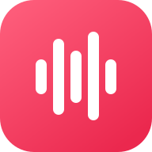
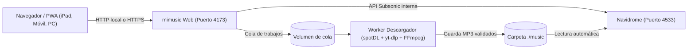

<div align="center">



# mimusic

**Tu propia app de música privada en casa, con diseño estilo Apple TV / Apple Music y descargador de canciones integrado.**

[](#cómo-instalarlo-paso-a-paso-sin-saber-programar)
[](#qué-puedes-hacer-con-mimusic)
[](#cómo-usarlo-en-tu-celular-o-ipad)

</div>

---

<table>
  <tr>
    <td width="50%">
      
      <p align="center"><sub><b>Reproductor</b> · Modo aleatorio, Repetir siempre y Una vez más (+1)</sub></p>
    </td>
    <td width="50%">
      
      <p align="center"><sub><b>Añadir música</b> · Busca canciones o pega enlaces de YouTube / Spotify</sub></p>
    </td>
  </tr>
</table>

## ¿Qué puedes hacer con mimusic?

- **Tener tu propio catálogo musical privado** sin anuncios, organizado automáticamente por álbumes, artistas, canciones y playlists (usando Navidrome por dentro).
- **Agregar canciones desde la misma página web:** pulsas **+ Añadir música**, escribes el nombre de la canción (o pegas el link de YouTube o de una canción de Spotify) y se descarga sola a tu biblioteca con portada y título.
- **Escuchar en cualquier pantalla:** en tu computadora, o abrirlo desde el navegador de tu **iPad, iPhone o Android** y agregarlo a tu pantalla de inicio como una aplicación.
- **Controles completos:** reproducción continua, modo **Aleatorio**, **Repetir siempre**, **Una vez más (`+1`)** y sesión recordada por 30 días para no escribir tu contraseña cada vez.

---

## Cómo instalarlo paso a paso 

No necesitas configurar servidores complicados ni instalar lenguajes de programación. Todo viene empacado listo para encenderse solo.

### Paso 1 · Instala Docker Desktop 
**Docker Desktop** es un programa gratuito que se encarga de instalar y encender todas las piezas de **mimusic** automáticamente dentro de tu computadora sin desconfigurar nada.

1. Entra a **[docker.com/products/docker-desktop](https://www.docker.com/products/docker-desktop/)** y descárgalo para Windows o Mac.
2. Instálalo como cualquier otro programa (si te pide reiniciar la PC, reiníciala).
3. **Abre Docker Desktop** y espera unos segundos hasta que termine de cargar (verás un ícono de una ballena abajo en tu barra de tareas). **Déjalo abierto.**

---

### Paso 2 · Descarga este proyecto desde GitHub
1. Sube al principio de esta página de GitHub y haz clic en el botón verde **`<> Code`**.
2. En el menú que se abre, haz clic en **`Download ZIP`**.
3. Ve a tu carpeta de **Descargas**, haz **clic derecho** sobre el archivo `.zip` que bajaste y elige **`Extraer todo...`** (o descomprimir).
   > **Importante:** Muévelo o extráelo en una carpeta normal (por ejemplo en *Documentos* o *Escritorio*). No intentes abrir los archivos desde adentro del `.zip` sin extraerlos primero.

---

### Paso 3 · Enciende mimusic

#### Si estás en Windows:
1. Abre la carpeta que acabas de extraer.
2. Haz **doble clic en el archivo `start.bat`** *(en algunos Windows puede verse solo como `start`)*.
   - *Nota: Si Windows muestra una ventana azul diciendo «Windows protegió su PC», haz clic en **Más información** y luego en **Ejecutar de todas formas**.*
3. Se abrirá una ventana negra que empezará a descargar y preparar todo automáticamente.
   - **La primera vez tardará entre 2 y 5 minutos** según tu internet. No cierres esa ventana hasta que aparezca el mensaje **«¡LISTO! Tu servidor mimusic ya está encendido»**.

#### Si estás en Mac o Linux:
1. Abre la aplicación **Terminal**.
2. Escribe `sh ` (con un espacio al final), arrastra el archivo `start.sh` de la carpeta hacia la ventana de Terminal y presiona **Enter**:
   ```bash
   sh start.sh
   ```
3. Espera de 2 a 5 minutos la primera vez hasta que diga **«¡LISTO!»**.

---

### Paso 4 · Crea tu usuario e inicia sesión (solo la primera vez)

Como el servidor es 100% tuyo y privado, primero debes inventar tu propio usuario y contraseña:

1. Abre en tu navegador: **`http://localhost:4533`**
   - Verás una pantalla de bienvenida (Navidrome). Inventa el **usuario y contraseña** que tú quieras y haz clic en crear cuenta. *(Anótalos para no olvidarlos).*
2. Ahora ve a la pestaña de **mimusic** que se abrió sola (o entra a **`http://localhost:4173`**).
3. Haz clic en el botón **Conectar mi biblioteca**, escribe ese mismo usuario y contraseña, pulsa **Probar conexión** y luego **Ver mi biblioteca**.

¡Eso es todo! Tu cuenta quedará guardada por 30 días en ese navegador.

---

### Paso 5 · Empieza a ponerle música

Tienes **dos formas muy fáciles** de llenar tu biblioteca:

- **Opción 1 — Descargar desde la página web:**
  1. Dentro de **mimusic**, haz clic arriba en **`+ Añadir música`**.
  2. Escribe el nombre de una canción con su artista (ejemplo: `Daft Punk - One More Time`) o pega el enlace de un video de **YouTube** o de una canción de **Spotify**.
  3. Haz clic en **Descargar al servidor**.
  4. Cuando la etiqueta cambie a **Guardada**, haz clic en el botón **Actualizar biblioteca** y ya aparecerá lista para reproducir.

- **Opción 2 — Copiar canciones que ya tengas en tu PC:**
  1. Entra a la carpeta del proyecto y abre la subcarpeta llamada **`music`**.
  2. Pega ahí adentro tus carpetas o archivos `.mp3`, `.flac` o `.m4a`.
  3. En **mimusic**, pulsa **Actualizar** y aparecerán con sus álbumes y portadas.

---

## Preguntas frecuentes del día a día

### ¿Cómo lo apago y cómo lo vuelvo a prender otro día?
- **Para apagarlo:** Entra a la carpeta y haz doble clic en **`stop.bat`** (en Mac/Linux: `sh stop.sh`). Tu música, tu cuenta y tus playlists quedan guardadas intactas.
- **Para volver a prenderlo:** Abre primero **Docker Desktop** y luego haz doble clic en **`start.bat`**. Como ya se instaló la primera vez, las siguientes veces encenderá en pocos segundos.

### ¿Cómo usarlo en tu celular o iPad?
- **Dentro de tu misma casa (mismo Wi-Fi):**
  1. Mantén el servidor encendido en tu PC.
  2. Mira la ventana negra que abrió `start.bat`: ahí mismo te mostrará una dirección parecida a `http://192.168.1.XX:4173`.
  3. Escribe esa dirección en el navegador de tu celular o iPad (Safari o Chrome) e inicia sesión.
  4. **Para tenerlo como App:** En Safari (iPhone/iPad) toca el botón **Compartir → Añadir a la pantalla de inicio**. En Android (Chrome) toca el menú **⋮ → Instalar aplicación**.

- **Fuera de tu casa (con datos móviles o desde otro lugar):**
  - Puedes conectarlo gratis y de forma privada usando **Tailscale** (sin abrir puertos peligrosos en tu módem). Tienes los pasos detallados en [esta guía opcional](MiMusicaWeb/DEPLOYMENT.md).

---

<details>
<summary><b>Información técnica, arquitectura y comandos para desarrolladores (clic para desplegar)</b></summary>

<br />

### Instalación rápida por terminal (Git + Docker Compose)
```bash
git clone https://github.com/g95410464-svg/mimusic.git
cd mimusic
docker compose up -d --build
```

### Arquitectura del stack


### Personalización avanzada (`.env`)
No es necesario crear un archivo `.env` para uso local. Si quieres cambiar puertos, apuntar a otra unidad de disco o configurar HTTPS con Tailscale, copia `.env.example` a `.env`:

| Variable | Por defecto | Descripción |
| :--- | :--- | :--- |
| `PORT` | `4173` | Puerto del reproductor web **mimusic**. |
| `NAVIDROME_PORT` | `4533` | Puerto del panel de Navidrome. |
| `MUSIC_DIR` | `./music` | Carpeta local con tu colección musical. |
| `DOWNLOADS_DIR` | `./music/mimusic` | Subcarpeta donde se guardan las descargas nuevas. |
| `APP_ORIGIN` | `http://localhost:4173` | Origen permitido (`https://...` al usar Tailscale o proxy inverso). |
| `NAVIDROME_PUBLIC_URL` | `http://localhost:4533` | Enlace que abre el botón «Abrir Navidrome» en ajustes. |

### Estructura del proyecto y pruebas automatizadas
- `docker-compose.yml`: Stack unificado (`navidrome` + `mimusic` + `downloader`).
- `MiMusicaWeb/`: Servidor Node.js 24 sin dependencias `npm`, interfaz PWA y tests (`npm run check && npm test` — 34 pruebas).
- `MiMusicaWeb/downloader/`: Worker aislado en Python 3.13 con `spotDL`, `yt-dlp` y `FFmpeg` (`python -m unittest discover -s MiMusicaWeb/downloader -p "test_*.py"` — 3 pruebas).
- Documentación técnica adicional: [Manual de la web y sesiones](MiMusicaWeb/README.md) · [Detalles del descargador](MiMusicaWeb/IMPORTS.md) · [Despliegue con Tailscale / Navidrome externo](MiMusicaWeb/DEPLOYMENT.md).

</details>
